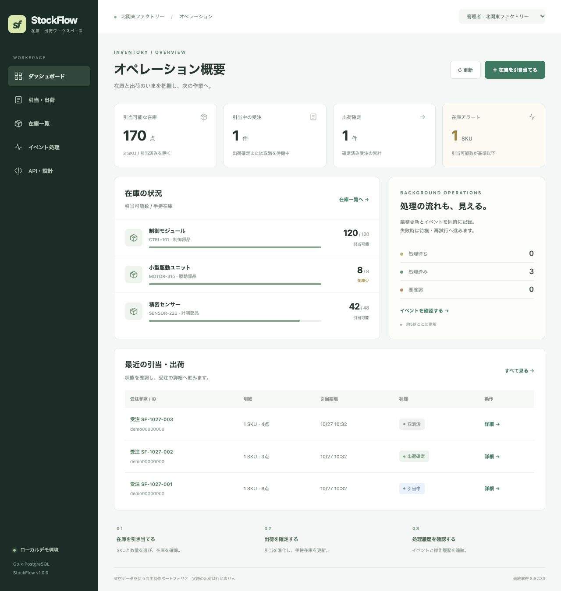

# StockFlow v1.0.1 — Go 在庫予約・出荷管理ポートフォリオ

製造部品の受注を想定し、在庫の引当から出荷確定・期限切れまでを管理する自主制作です。複数の注文が同時に届いても、在庫の過剰引当や二重処理を防ぐ設計を、実際のPostgreSQLを使ったテストで確認しています。



## 起動

Docker Desktopを起動し、このREADMEがあるフォルダーで実行します。

```sh
docker compose up --build -d app
```

ブラウザーで http://localhost:8080 を開いてください。初回はイメージの取得・ビルドに数分かかります。架空の在庫・注文が自動で入り、画面右上から役割を切り替えられます。実データ・本番認証には使用しないでください。

```sh
docker compose logs -f app
docker compose down
```

停止後もDBの名前付きボリュームにデータを保持します。`down -v`はデータも削除するため、通常の停止には不要です。

## 試せること

1. ダッシュボードで在庫・予約・出荷件数を確認する。
2. 「予約を作成」から複数部品を選び、在庫を引き当てる。
3. 予約詳細から出荷確定または取消を実行し、在庫と操作履歴を確認する。
4. 閲覧担当・別テナントに切り替え、操作権限とデータの分離を確認する。
5. イベント処理画面で配送台帳への処理状態を確認する。

詳しい操作例・障害再現は[デモ手順](docs/DEMO.md)を参照してください。

## 技術と設計

| 項目 | 実装 |
| --- | --- |
| API | Go 1.27.3 / Gin 1.12 / REST / OpenAPI 3.0.3 |
| DB | PostgreSQL 17 / pgx / SQLマイグレーション |
| 整合性 | 行ロック、トランザクション、DB制約、楽観的バージョン検査 |
| 二重送信 | 要求キーと正規化した内容の照合、同じ結果の再取得 |
| 非同期処理 | Transactional Outbox、並行ワーカー、再試行、失敗イベントの再開 |
| 画面 | React 19 / TypeScript / レスポンシブ表示 |
| 運用の基礎 | JSONログ、ヘルスチェック、終了処理、Docker、GitHub Actions定義 |
| クラウド設計 | AWS ECS / RDS / ALB / Secrets ManagerのTerraform構成例 |

配送処理先は同じDB内の配送台帳です。外部の配送サービスは接続していません。AWSは構成検査までで、配備・運用は未実施です。Go案件の実務年数を示す作品ではありません。

## ローカルデモ認証

これらは公開済みのデモ専用キーです。画面の役割切替とAPIの`Authorization: Bearer ...`に利用できます。

| キー | 役割 | テナント |
| --- | --- | --- |
| demo-manager-a | 管理者 | factory-a |
| demo-operator-a | 操作担当 | factory-a |
| demo-viewer-a | 閲覧担当 | factory-a |
| demo-manager-b | 管理者 | factory-b（初期データなし） |

API仕様: http://localhost:8080/openapi.json

## 検証

```sh
docker compose --profile test run --build --rm tests
```

このコマンドは実DB接続を必須として、整形、依存整合性、静的解析、競合検出付きGoテストを実行します。ビルド時にフロントエンドの型検査と3件のテストも実行します。

2026年10月27日のv1.0.1改修後一次審査で、Goトップレベル42件（サブテスト込み66件）・フロントエンド3件が成功しました。最新再審査の文カバレッジ72.0%。対象回帰テスト各5回成功。依存監査は到達可能0件、未使用openpgpに関するモジュール注意情報1件です。[検証記録](docs/VALIDATION.md)・[改修と一次審査報告](docs/PRIMARY_REVIEW.md)を参照してください。Codexによる自己審査です。

## 資料

- [Go案件の要求スキル調査](docs/RESEARCH.md)
- [要求と実装の対応表](docs/REQUIREMENTS_MATRIX.md)
- [設計・整合性の保証範囲](docs/DESIGN.md)
- [AWS構成例と未検証範囲](docs/CLOUD.md)
- [完成範囲と制約](docs/LIMITATIONS.md)
- [応募時の作品説明](docs/PORTFOLIO.md)
- [Claudeでの反証レビュー手順](docs/COUNTER_REVIEW.md)

作品固有のライセンス条件は未指定です。依存ソフトウェアはそれぞれのライセンスに従います。

## 公開先

https://github.com/no-dev-portfolio/stockflow-go-portfolio

[最新の一次再審査結果](docs/PRIMARY_REREVIEW_1_0_1.md)。Go66件・画面3件、対象回帰各5回成功。
