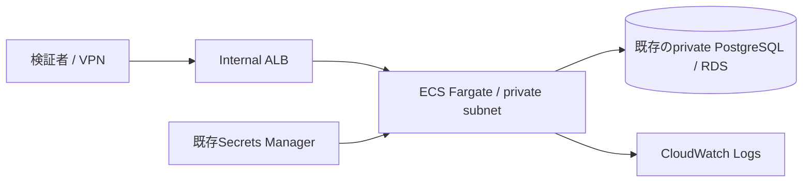

# AWS検証環境への構成案

**実施範囲はTerraformの構成検査まで。AWSへのplan/apply、イメージのECR配布、RDS接続、稼働・費用・可用性の検証は未実施。**



`deploy/aws/main.tf`は、既存VPC・private subnet 2つ以上・既存の検証用DB・接続URLのSecret・ECRへ配置済みのARM64 image digestを入力する構成例。既定値enabled=falseでリソース作成を無効にしている。

- 内部ALBのみ。インターネット向けのALBを作らない。VPN等の既存の到達経路が必要。
- ALBへの入力CIDRは明示し、/16以上に限定。taskはALBのSG、DBはtaskのSGからのみ5432を許可。
- taskのpublic IPは無効。ECR/Secret/Logs取得用の既存VPC endpointまたはNATが別途必要。
- taskは非root、read-only。execution roleはSecretの指定ARNだけを参照。カスタムKMS鍵の場合のDecrypt権限は別途設計が必要。
- CloudWatchの保存期間は7日。CPU 256 / memory 512、1 taskは検証用の出発点であり、性能設計値ではない。
- 健全性は/readyz。接続URLのTLS方式・CA trustはRDSの要件に合わせて別途用意する。

## 構成検査

```sh
cd deploy/aws
terraform fmt -check
terraform init -backend=false
terraform validate
```

実行にAWSアカウントの秘密を渡していない。providerの取得にはネット接続を使う。Terraform 1.13.4 / AWS provider 6.69.1で検査し、lockファイルを同梱する。

## applyの前に解決する点

本アプリはDEMO_MODE=trueと公開デモAPIキーを使用するため、本番サービスとして外部公開しない。内部HTTPの構成例を、本番のTLS/認証基盤と同一視しない。クラウド検証を実際に行う場合は、到達者を限定した隔離環境で、証明書・ネットワーク・権限・移行手順・監視・バックアップ・費用上限・削除計画を別途検討する。既存DBには本番データを入れない。

## 本番化の設計課題

利用者管理とOIDC/鍵ローテーション、HTTPS、DB CA検証、DDLを実行する移行ロールと通常接続の分離、複数AZ、最小権限、外部台帳への冪等性、永続的レート制限、監視通知、ログの個人情報取り扱い、災害復旧、ストレージ/ログの保持方針が必要。

この構成例を用意したことはAWS本番実務経験の代替にならない。
