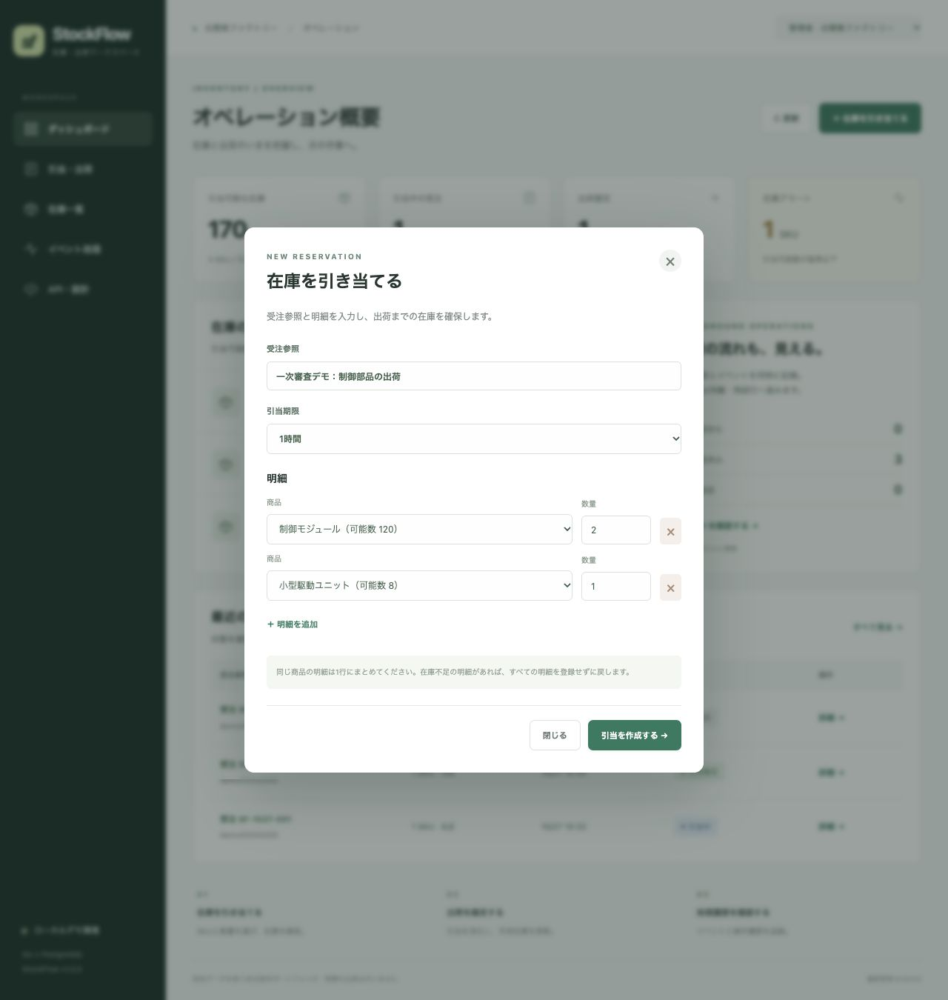
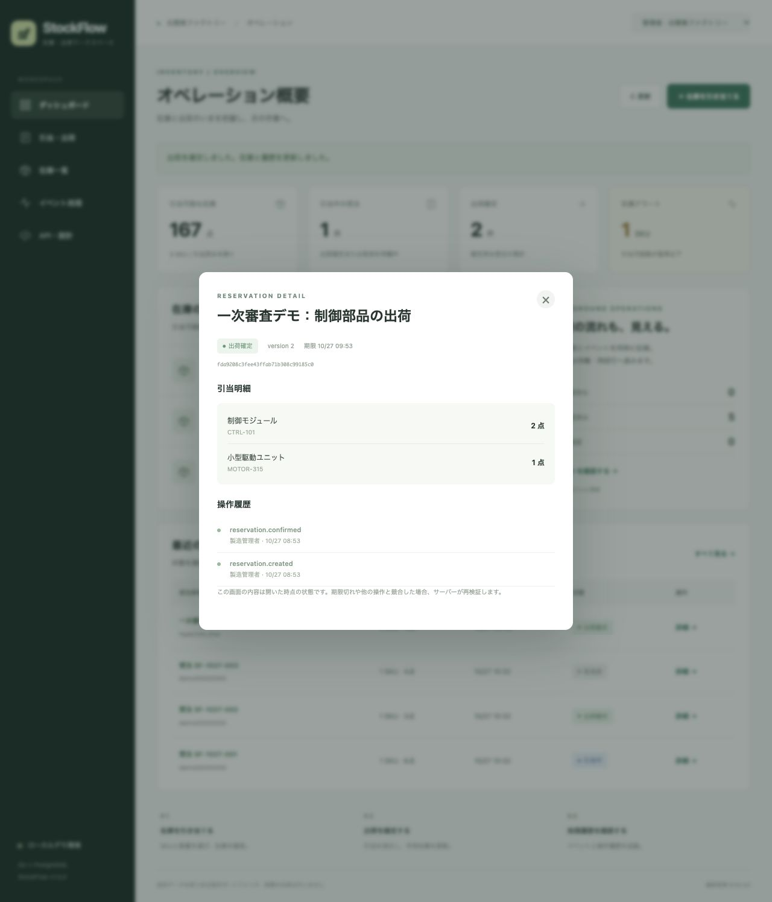
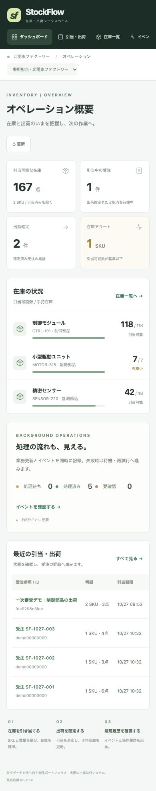

# デモ操作手順

## 初回の確認（約3分）

READMEのDocker Composeで起動し、http://localhost:8080 を開きます。新規ボリュームで起動直後の在庫引当可能数は170、引当中1件、出荷確定1件、在庫注意1商品です。配送イベント3件はワーカー実行後に処理済みになります。操作後は値が変わります。

1. 管理者Aで「予約を作成」を開きます。参照番号を入力し、制御モジュール2個、小型駆動ユニット1個を選びます。
2. 作成すると引当可能数は167になります。詳細で引当中・バージョン1を確認します。
3. 出荷確定すると確定・バージョン2になり、実在庫も減ります。同じ予約を繰り返して確定しても二重に消費しません。
4. 画面右上で閲覧担当に切り替えると、作成・変更ができなくなります。管理者BにはAの在庫・予約が表示されません。





## 期限切れ

新しい予約の有効期間を30秒に設定し、出荷確定せずに待ちます。画面は約5秒周期で更新され、ワーカーが期限切れにして引当を戻します。期限判定にはDBの時計を使います。表示時刻は利用ブラウザーのタイムゾーンに従います。

## 配送失敗と再開

```sh
DEMO_DELIVERY_FAILURES=5 docker compose up -d --force-recreate app
```

予約を作成し、イベント画面を開きます。各イベントの配送台帳登録を最大5回失敗させ、待機間隔2、4、8、16秒を経て失敗状態になります。これはローカルの模擬障害です。管理者だけが失敗イベントを再試行できます。

```sh
DEMO_DELIVERY_FAILURES=0 docker compose up -d --force-recreate app
```

障害設定を戻してから、管理者で再試行してください。配送台帳のイベントID制約で重複登録を防ぎます。外部HTTP配送の動作検証ではありません。

## API・テスト

OpenAPIファイルをPostman等に読み込めます。作成には8〜80文字の`Idempotency-Key`を付け、結果が不明な場合には同じキー・同じ内容で再送します。同じキーで内容を変えると409になります。

```sh
docker compose --profile test run --build --rm tests
```

テストは個別のDBスキーマを使います。画面用データの初期化や削除を目的にしません。



初期の引当中予約は投入から2時間で失効します。既存ボリュームには再投入しないため、後日再起動した場合の件数は初期例と異なります。新しい予約を作成してデモを続けてください。
