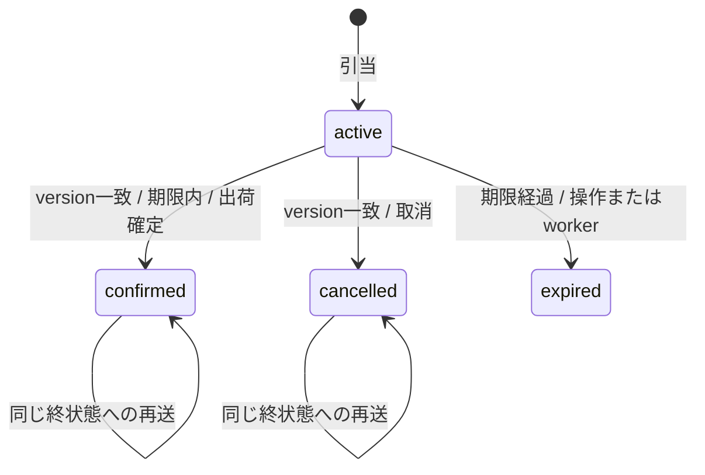
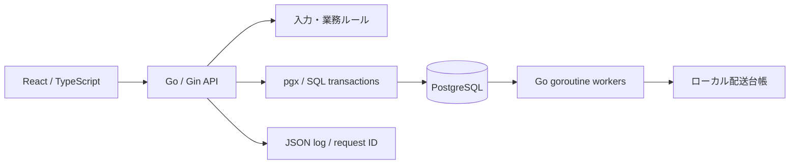

# StockFlowの設計

## 業務と不変条件

製造・物流の受注について、在庫確保から出荷確定までを記録する。架空の3 SKUを用いる。物理的な出荷・配送事業者連携・決済は行わない。

- `0 <= reserved <= on_hand`。引当可能数は常に `on_hand - reserved`。
- 明細は1～10 SKU、1 SKUあたり1～10,000点。重複SKUを拒否。
- 一括引当は全件成功か全件不成立。途中の在庫変更・キー・履歴を残さない。
- 組織は認証されたAPIキーから決定。リクエストのtenant指定は受け付けない。
- manager/operatorは引当・状態変更可、viewerは参照のみ。失敗イベントの再処理はmanagerのみ。
- 引当中の明細は変更しない。発注後の在庫増減や受注変更は対象外。

confirmedではreservedとon_handをともに減算。cancelled/expiredではreservedだけを減算する。確定済み・取消済み・期限切れから別の終状態へは遷移できない。期限切れ後の確定・取消の再送は一貫して409 expiredを返し、在庫・イベントを再更新しない。同じ確定済み・取消済み操作は、正の古いversionでも200を返す再送契約である。

## 構成

`internal/domain`は入力と契約、`internal/httpapi`はHTTP・認証・エラー変換、`internal/store`はSQLと業務取引、`internal/worker`は期限解放・イベント処理のスケジュールを担当する。小規模作品であるため、全テーブルのRepository interfaceやマイクロサービス分割を増やしていない。SQLを明示し、DB経験を追跡しやすくした。

## データ

- tenants：組織
- stock：組織＋SKUの複合主キー、数量制約
- reservations：受注参照・状態・期限・version
- reservation_items：組織付き複合外部キーで別組織のSKU/受注の混在を防ぐ
- idempotency：組織＋要求キーの一意性と内容ハッシュ
- outbox：業務操作に対応するイベント、試行回数、次回日時、状態
- delivery_receipts：event_idの一意なローカル処理完了記録
- audit：成功した業務操作と再処理指示の履歴
- schema_migrations：埋め込みSQLの適用版。初回DDLはadvisory lock下の取引で適用

一覧はlimit/offsetで最大100件、イベントは直近100件。受注明細は一覧分をまとめて取得し、各受注ごとのN+1を避けた。サマリーはSQLで計算する。索引は組織別一覧、期限対象、処理待ち対象、履歴を意識する。少数の架空データでの動作確認であり、大規模性能を保証しない。

## 引当・再送

1. 権限・型・値域を検証し、参照文字列の前後空白を除去、明細をSKU順に整列。
2. 正規化したJSONのSHA-256を計算。
3. 組織＋要求キーのトランザクションadvisory lockを取得。
4. 同じキーがあれば内容ハッシュを比較。同内容は同じ受注の現在状態を返す。異内容は409。
5. 在庫行をSKU順にFOR UPDATEで確保。1明細でも不足ならロールバック。
6. 在庫・受注・明細・冪等キー・Outbox・操作履歴を同じ取引で確定。

要求キーは8～80文字。画面はランダムUUIDを生成。SHA-256のハッシュ値自体で業務同一性を判断せず、DB上の組織・キー一意制約も併用する。新しいキーを使った同一受注参照の再作成まで防ぐ設計ではない。

## 確定・取消と期限

受注行のロックで同じ受注の遷移を直列化し、version一致を確認する。その後、対象在庫行をSKU順にすべてロックし、**ロック待機後にDB時計で期限を再判定**する。期限後は確定を拒否し、期限切れへの遷移・在庫解放を確定して409を返す。

期限の判定点は必要な行ロック取得後のDB時計確認時点。通信の完了時刻やクライアントの時計では判定しない。外部のDDL・無制限に長いトランザクションを含む厳密なコミット時刻保証ではない。

## Outbox・期限worker

2つのgoroutine workerが最大50件/巡回で処理し、行をFOR UPDATE SKIP LOCKEDで確保する。期限解放とイベント処理を巡回し、片方の対象だけで永久に回り続けないようにする。

処理先は同じPostgreSQL内のローカル配送台帳。台帳挿入とOutboxのdelivered化は同じ取引。event_id一意制約で処理済みを重複登録しない。外部HTTP配送についてexactly-onceを実現したとは主張しない。

`DEMO_DELIVERY_FAILURES=1..5`は一時失敗を意図的に発生させる検証設定。2/4/8/16秒…のバックオフ、5回でfailedにする。managerによる再処理はfailedのみをpendingへ戻し、履歴へ記録する。障害設定を残したまま再処理すれば再度失敗する。

## HTTP・終了・認証

JSONは64KiB上限、未知フィールド・不正型・複数オブジェクトを拒否。Content-Typeはmime.ParseMediaTypeでapplication/jsonと照合。415/400/401/403/404/409/503を使い分け、エラーにはrequest_idを付ける。

認証はローカルデモ用の固定Bearer APIキー。HTTPログにAuthorization・クエリ・要求本文を出さず、routeとrequest_idをJSONで記録する。DB問い合わせにはcontextを伝播し、要求は5秒・DB statement timeoutも5秒。rollbackは別の3秒contextで後処理する。

SIGTERM/SIGINTではHTTPを最大12秒で終了させ、workerを止めてプールを閉じる。Dockerは非root・read-only root filesystem・capabilitiesなし。Composeのホスト公開は127.0.0.1のみ。healthコマンドはLISTEN_ADDRのポートを使用し、0.0.0.0・空ホストは127.0.0.1、IPv6の::は::1へ接続する。

## 画面の応答競合

利用者切替は進行中の読取・変更応答を無効化し、前の組織のデータをクリアする。読取は要求世代とAbortController、操作履歴は別世代で古い応答を除外する。ネットワーク失敗で引当の結果が不明になった場合は、同じ内容とキーを保持して再送する。サーバーが唯一の業務判定主体であり、ボタンを隠すことを認可の代わりにしない。

## 本番化との境界

利用者・秘密鍵の管理、OIDC、永続的なレート制限、監査保全、バックアップ復旧、外部配送先の重複防止、TLS、監視通知、負荷検証、DBの実行/移行権限分離が必要。AWS構成例はプライベート検証環境向けの設計・静的検査であり、本番運用済みではない。
